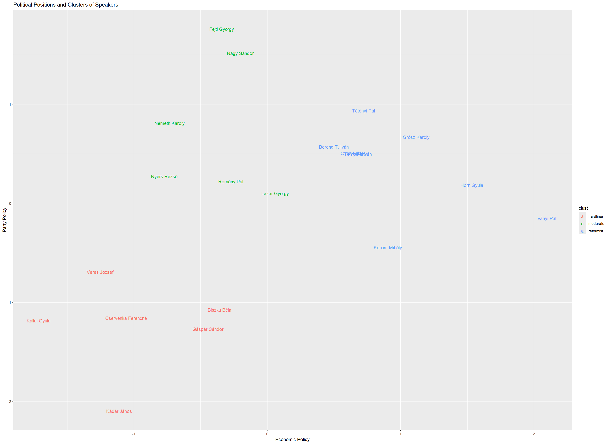
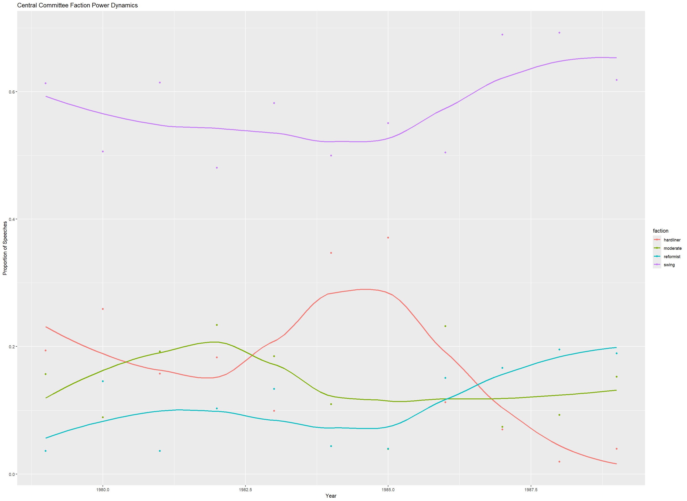

# Quantitative text analysis of the MSZMP Central Committee records (1956–1989)

An R pipeline that builds a speech-level corpus from the digitised minutes of the Central Committee of the Hungarian Socialist Workers' Party (MSZMP) and uses it to study political positions and factional dynamics in the late Kádár era.

Originally developed as a course project in quantitative text analysis.

## Data

- **Source:** the MSZMP minutes collection of the Hungarian National Archives' online databases ([adatbazisokonline.mnl.gov.hu](https://adatbazisokonline.mnl.gov.hu)), Central Committee sessions.
- **Size:** 190 digitised PDF documents, roughly 87 million characters of raw text; the cleaned corpus keeps 1,884 speeches of 2,000–20,000 characters.
- **Unit of analysis:** one speech (one speaker turn), with speaker name, session date, agenda topic and era.

The cleaned speech-level corpus (`cleandata.csv`) is included, so `04_analysis.R` can be run directly. The PDFs and the raw corpus are not included; running `01_scraping.R` and `02_assembly.R` downloads the documents and rebuilds them.

Note: the included `cleandata.csv` was produced with an earlier version of `03_cleaning.R`, in which the lemmatised tokens were not written back to the text. Rerunning the current script produces a lemmatised version.

## Pipeline

| Script | What it does | Output |
|---|---|---|
| `01_scraping.R` | Collects document and metadata links from the archive's search pages (headless browser, `rvest`) and downloads the PDFs in parallel | `pdfs/`, `techdata.csv` |
| `02_assembly.R` | Extracts text from the PDFs, splits it into speeches by detecting speaker lines (fuzzy matching on *elvtárs:* / *elvtársnő:*), attaches session date and agenda topics from the metadata pages, harmonises speaker names with Levenshtein distance, and assigns each speech to one of four eras | `rawcorpus.csv` |
| `03_cleaning.R` | Normalises the text, removes OCR noise, general and corpus-specific stopwords and sparse terms, lemmatises with `udpipe` (Szeged UD model), and keeps speeches between 2,000 and 20,000 characters | `cleandata.csv` |
| `04_analysis.R` | See below | plots |

### Analysis (`04_analysis.R`)

1. **Political compass, 1979–1989.** Two Wordfish models, one on economic and one on party-policy speeches, give each speaker a position on two axes.
2. **Factions.** k-means clustering on the two positions; the number of clusters (3) is chosen with the gap statistic.
3. **Factional dynamics.** The share of speaking time held by each faction, per session and per year.
4. **Kádár's rhetoric over time.** Yearly net sentiment of János Kádár's speeches (Poltext dictionary from `HunMineR`), with structural breaks estimated by `strucchange::breakpoints`.

Eras used throughout: 1956–1962, 1963–1968, 1969–1978, 1979–1989.

### Figures

**Political positions and clusters of speakers (1979–1989)**

**Factional share of speaking time in the Central Committee**

**Net sentiment of Kádár's speeches, with estimated structural breaks**

## Requirements

R packages: `webdriver`, `rvest`, `stringr`, `stringi`, `stringdist`, `dplyr`, `reshape`, `reshape2`, `pdftools`, `parallel`, `quanteda`, `quanteda.textmodels`, `quanteda.textplots`, `udpipe`, `HunMineR`, `cluster`, `factoextra`, `strucchange`, `ggplot2`.

Also needed:

- PhantomJS for `01_scraping.R` (`webdriver::install_phantomjs()`)
- the udpipe model `hungarian-szeged-ud-2.5-191206.udpipe` in the working directory (`udpipe::udpipe_download_model("hungarian-szeged")`)

Run the scripts in order from the repository root.

## Known limitations

- Speakers are detected from lines ending in *elvtárs:* / *elvtársnő:*. OCR errors can merge or split speeches.
- OCR quality varies. Non-Hungarian characters are removed rather than normalised, and tokens shorter than four characters are dropped as noise.
- Sparse terms are removed before lemmatisation, so some rare inflected forms are lost.
- Agenda topics come from a hand-built keyword dictionary.
- A few PDFs could not be parsed and are missing from the corpus.
- k-means cluster numbers are arbitrary. The faction labels in `04_analysis.R` were assigned by inspecting the centroids and should be rechecked if the data change.

`03_cleaning.R` ends with a longer discussion of these choices.

## Author

Kolos Mohácsi
